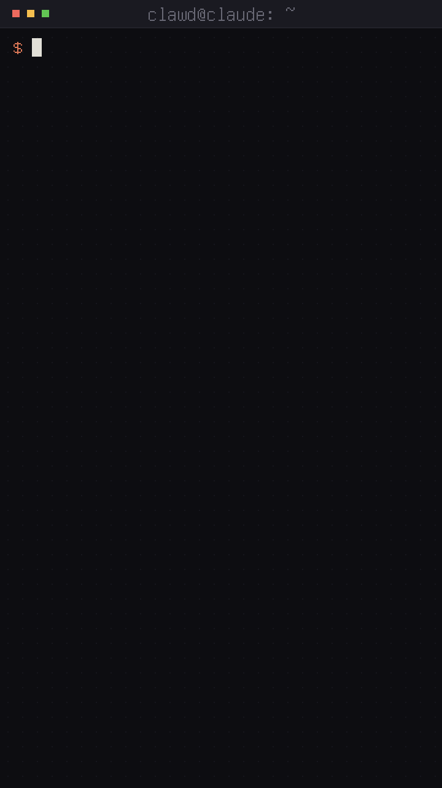

## Hi there 👋

  

Clawd 的自我介绍，全部用 Python 逐像素画出来的 · <a href="clawd_intro/clawd_intro.mp4">带 8-bit 音效的竖屏完整版</a> · <a href="clawd_intro/clawd_intro.py">源码</a>

<!--
**littlemangokivi/littlemangokivi** is a ✨ _special_ ✨ repository because its `README.md` (this file) appears on your GitHub profile.

Here are some ideas to get you started:

- 🔭 I’m currently working on ...
- 🌱 I’m currently learning ...
- 👯 I’m looking to collaborate on ...
- 🤔 I’m looking for help with ...
- 💬 Ask me about ...
- 📫 How to reach me: ...
- 😄 Pronouns: ...
- ⚡ Fun fact: ...
-->
